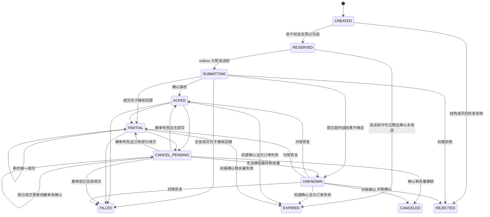

<!-- copied byte-identical from evolving-alpha codex/lunhui-agent-design @ 2ae4df0, 2026-10-19 -->
# 风控与验证

设计日期：2026-10-01（用户时区）。本文件定义风险边界、账本不变量与后续验收合同。表中的测试和指标均为计划，尚未实现或执行，也没有回测收益结果。

## 1. 文档经验进入系统的边界

《轮回》P0011–P0012 的“计划交易”“没有模式内的就不买”应成为最高层行动约束；P0015 提到的一字撤单必须服从交易时段与真实确认；P0205/P0188 的重仓、满仓属于作者经验，不直接成为仓位参数；P1636–P1643 的预期差必须以事前冻结的预期验证。P1694–P1708 展现的不同市场生态说明固定规则可能失效。

系统应把“龙头”“冰点”“弱转强”“唯一反弹”保存为可证伪的研究假设。每个假设都有可观测特征、成立条件、失效条件、适用阶段、反例与文档来源，禁止用事后涨幅反推当时“已经是龙头”。各类市场状态为带置信度的估计；证据不足时允许 UNKNOWN 和不交易。

## 2. 已核实的当前交易规则

- 沪深《交易规则（2026 年修订）》均自 2026-07-06 施行；沪市明确主板风险警示股票涨跌幅由 5% 调整到 10%。历史回放必须按交易日选择规则，不能把“ST 一律 5%”写成永久常量。[上交所修订发布说明](https://www.sse.com.cn/aboutus/mediacenter/hotandd/c/c_20260424_10816474.shtml)、[深交所发布通知](https://investor.szse.cn/lawrules/rule/trade/t20260424_620190.html)。
- 深市现行规则中，普通股票买入在交收前不得卖出；竞价交易分集合竞价和连续竞价；9:20–9:25、14:57–15:00 不接受竞价撤单；买卖及撤销申报经交易主机确认才生效；撮合有价格与时间优先，未成交部分可继续竞价。主板一般涨跌幅 10%、创业板 20%；具体例外及数量、价格单位、价格笼子应由适配器执行。[深交所 2026 交易规则，3.1.4、3.3、3.4](https://docs.static.szse.cn/www/lawrules/rule/trade/current/W020260424690713155663.pdf)。
- 2026 规则扩展了盘后固定价格交易范围。MVP 若只覆盖连续竞价，应明确这是产品范围；不能再声称 A 股 15:00 后没有任何交易。[上交所修订发布说明](https://www.sse.com.cn/aboutus/mediacenter/hotandd/c/c_20260424_10816474.shtml)。
- 真实接入前另行完成券商准入与适用程序化交易报告；自动生成指令也在程序化交易定义内，人工点击不应被假定为免责。证监会管理规定自 2024-10-08 施行，上交所实施细则自 2025-07-07 施行。[证监会发布说明](https://www.csrc.gov.cn/csrc/c100028/c7480577/content.shtml)、[上交所实施细则](https://www.sse.com.cn/lawandrules/sselawsrules2025/trade/universal/c/c_20250612_10781696.shtml)。

MVP 范围：普通沪深主板 A 股现货、无杠杆、只支持连续竞价限价委托；不覆盖新股无涨跌幅日、风险警示、退市整理、停牌、科创板、创业板、北交所、可转债、盘后交易与集合竞价排队成交。竞价数据可以作为开盘后决策依据。排除品种也需要在数据历史上保留，避免幸存者偏差。准入判断对每个历史时点独立执行，不能永久剔除后来成为风险警示或退市的股票。

## 3. 数据与回放的强制不变量

每条行情/公告/题材归属/证券状态至少保存 `event_time`、`published_at`（适用时）、`received_at`、`available_at`、来源、版本、修订链。交易时钟是交易所日历和 Asia/Shanghai，不随开发机器时区变化。策略在决策时间 `t` 只能看到 `available_at <= t` 的版本；事件发生时间不等于系统获知时间。

- 后来补录、修订的新闻不能回填到首次事件时间。题材成员、ST 状态、停复牌、涨跌停价、股本与指数成分都使用当时快照。
- 日内策略只读取已完成的 bar 或明确标记的当时累积值；不能使用最终日成交量、最高价、收盘板块热度、收盘涨停名单。当天龙虎榜只能在实际披露可用之后进入下一次决策。
- 当前候选池不能回推历史。保留退市、失败题材和失败龙头。复权价格用于研究时须有可用日一致性；委托、资金账与撮合采用当时真实可交易价格，除权除息独立记账。
- 封单金额不是可成交金额；L1 快照不是逐笔队列。数据不支持的特征必须返回 MISSING，禁止 LLM 猜测。大额封单应按流通市值、成交规模等归一化，并把《轮回》的固定“亿”阈值视为待验证参数。
- 历史 LLM 回放即使屏蔽未来行情，也可能从预训练知识记得著名牛股结局。记录该限制；采用匿名标的实验、禁用回放时联网、同事件去未来版本对照，并把冻结策略之后的前瞻 paper 作为必要证据。匿名化只能缓解，不能证明零污染。

回放可分两种：A）固定录制的 LLM 输出，严格验证事件、账本与执行确定性；B）重新调用固定模型/提示的策略评估，单独报告输出漂移。不可要求未保证确定性的远端模型每次重跑逐字一致。

## 4. LLM 与风控分权

LLM 只提交结构化 `TradeIntent`：候选、证据 ID、假设 ID、预期与失效条件、拟定方向/价格/仓位、最晚执行时间。确定性风险引擎拥有最终允许或拒绝权，拒绝原因结构化记录。dsh worker 无交易凭据、无风险配置写权限、无订单直接发送权限。

风险引擎顺序检查：账户模式 → 数据有效性与时效 → 标的和时段 → 价格/数量合法性 → 可卖数量或可用现金 → 单标的/题材/总敞口与流动性 → 在途订单/未知状态 → 回撤与日损失禁开仓 → 意图有效期。下单前基于最新账本与行情再检查，不能把数十秒前的分析许可当作永久授权。

网页、公告和研报是数据，不是指令；提示注入、要求关停风控、修改预算、访问凭据的文本只能被当作无效内容。证据缺失、结构无效、模型超时或数据落后均可产生合法 `WAIT`；风险引擎在模型不可用时仍能接收成交、维护账本和处理既有订单。

仓位与损失参数属于版本化实验配置，由确定性策略设上限。不要把止损价当成可保证损失上限：T+1、新买锁仓、跳空、连续跌停均可能使退出失败。Kill switch 的语义是禁止新风险、尝试合法撤单、对可卖持仓按可成交条件处理；它不承诺瞬间空仓。

### 4.1 风险参数与保守 paper 初值

以下数字仅用于首轮模拟的保守起点，未经过收益优化或样本外验证，也不是用户实盘账户的风险配置。所有限制取最严格者；若最小可交易数量已超过许可额度，就不下单。`E` 为带时间戳的账户净值；风险暴露同时计入当前持仓和所有未终结买单，未知订单按可能全部成交处理。卖单在成交确认前不抵扣持仓风险。

| 符号 / 配置键 | 定义与计算 | paper 初值 | 触发行为 |
|---|---|---|---|
| `G_max / gross_exposure_cap` | 持仓市值 + 在途买单最大剩余金额，占 `E` 的比例 | 30% | 拒绝新增至上限以外的风险 |
| `S_max / symbol_exposure_cap` | 单标的同口径暴露占 `E` | 10% | 拒绝该标的新增 |
| `T_max / theme_exposure_cap` | 同题材成员暴露占 `E`；多题材股对每个相关题材全额计入 | 20% | 拒绝放大集中度；题材不明则禁止新开仓 |
| `O_max / order_notional_cap` | 单次订单最大名义金额占 `E` | 2.5% | 下调至合法整数数量或拒绝 |
| `N_max / holding_count_cap` | 非零持仓及已获预占的新标的数量 | 4 个 | 不新增第五个标的 |
| `L_day / daily_loss_gate` | 调整外部出入金后，净值较日初净值的跌幅，含未实现盈亏 | 1% | 锁定当日禁止新增；保留确定性管理已有风险 |
| `D_max / drawdown_gate` | 当前净值较该实验版本净值高水位的回撤 | 5% | 暂停该版本新增，生成研究复核事件 |
| `V_cap / trailing_volume_fraction` | 单笔数量相对该时点已完成的最近 5 分钟成交量 | 0.5% | 数量取该限制、现金限制与其他上限的最小值；缺数据拒绝 |
| `p_fill / fill_participation_cap` | 撮合窗口内模拟成交占订单到达后可观察合格成交量的上限 | 1% | 仅限制模拟 fill，不能据此保证真实可成交 |
| `A_quote / max_quote_age` | 下单再校验时盘口事件时间与实际接收时间的最大年龄，另验时钟偏差 | 2 秒 | 数据过期拒绝；刚收到的旧行情也拒绝；分钟数据不能假装满足该条件 |
| `A_signal / max_signal_age` | 最新决策快照相对发送时点的最大年龄，与报价年龄分别检查 | 30 秒，且未发生失效事件 | 超龄、任务修订落后或新公告否定原计划时重新研究；这是待压测的初值 |
| `TTL_intent / intent_validity` | 模型完成结构化意图后的有效期 | 最长 5 秒，且不跨当前连续竞价时段 | 过期重新形成意图和风控许可 |
| `TTL_permit / permit_validity` | 原子预占后尚未开始发送的许可有效期 | 最长 2 秒，且不晚于意图到期 | 若仍未发送，可原子撤销许可并释放预占 |
| `R_submit / account_submit_rate` | 账户级新单发送频率，另有撤单与查询预算 | 至多 1 次/秒 | 短时排队后若许可过期则放弃；不得排队到未来窗口执行 |

这些参数仍有跳空和失去流动性导致的超限风险。市场价格波动造成暴露越限时禁止继续增加，按照可卖数量和流动性执行已登记的降仓规则，不记虚构成交。日损失和回撤门槛是行为闸门，不是保证最大亏损。日损失闸门不得盘中自动解除；回撤闸门需发布复核后的新版本或显式恢复决策。行情无法可靠估值时停止新增，而非使用旧净值证明“尚未超限”。

费用不设固定全国统一佣金假设：回放按日期绑定税费表，paper 按模拟账户费率表，均记录版本及最小收费。买单预占包含最坏合法成交金额与费用上界；费用模型缺失时不放行。发布前应对表中参数做灵敏度和故障压力检验，不以最佳历史收益反推“安全”初值。

## 5. 订单和账本

推荐订单状态如下；状态转换都进入不可变事件日志，订单状态与累计成交量分开保存。

图中 `REJECTED` 不回滚已发生的有效成交；矛盾回报进入对账冻结。`EXPIRED` 必须区分“本地发送前作废”和“已发送订单被权威确认失效”。意图、风险许可到期后，已发送的订单也不会因此在交易所自动消失。

### 5.1 原子 pretrade reservation

一个账户事务锁定账本版本，读取最新账户和证券状态，校验所有门槛，计算最坏资金/可卖数量预占，再写入 `RESERVED` 订单、风险许可、预占分录和 outbox。全部成功才提交；任何一步失败都不产生可发送记录。网关只能认领已提交的 outbox，并以同一幂等键发送。网络发送不放在数据库事务中。

预占到发送之间仍需校验许可有效期、价格范围、交易状态和数据年龄；校验失败且尚未开始发送时原子作废。只要已经尝试发送就不能靠本地超时释放预占，须先确认外部事实。账户行版本比较或等价的可串行化控制是资金一致性的边界，多个 dsh 角色均不能绕过。

- 意图 ID 与订单 ID 分离；订单幂等键在第一次发送前持久化。重复提示、工具重试、网络重发、进程重启都不能产生第二份经济风险。若券商接口不支持幂等键，必须依赖查询和可靠标识关联；查询不确定时停止新增风险，不盲重发。
- 发送前原子完成风险校验、买单现金加最坏费用预占，或卖单可卖数量预占。并发通过者必须串行化到账户级账本，防止两张订单各自看到同一笔可用余额。
- `available_cash = spendable_cash - active_cash_reservations - unreserved_confirmed_fees`。其中 `active_cash_reservations` 已包含在途买单余量与其费用上界，`unreserved_confirmed_fees` 只计尚未从现金扣除且不在预占内的已确认费用，防止重复扣费。总持仓与可卖持仓分开；可卖数按历史持仓、当日买入锁仓、卖单预占、公司行动调整。卖出回款“可用”与“可取”分开，不凭经验统一当作已结算现金。
- 部分成交仅扣减成交部分，余量仍预占；买单改善价格可释放已确认的价差，但不能释放未成交订单需要的额度。未确认撤单不释放。未知状态不因时间到期自行释放。
- 用成交唯一 ID 去重；乱序处理不允许累计成交量倒退；终态后收到更晚有效成交仍须进入对账流程。除正常费用外，账本金额采用定点数，数量采用整数。每次重启先恢复账本并对账，后允许新下单。
- `UNKNOWN` 是本地不确定性标签，不等于交易所撤单或拒单。查询、回报、持仓及资金无法一致时冻结相应账户新增风险并记录需要人工处理的差额。

## 6. 撮合假设与不可成交情形

日线数据仅能验证较慢的隔日研究，不能支持打板/竞价队列收益结论。分钟线缺失同一分钟内先后顺序；不使用“最低价碰到就成交”和同根 bar 先买后卖的最优路径。

MVP 优先用逐笔或足够频率的盘口增量构建保守撮合；没有队列数据时，一字涨停买入与跌停无买盘卖出默认不成交。触及限价只产生成交可能，成交量受可观察对手盘、参与率、延迟、已有排队量假设约束。所有排队近似与成交模型参数必须写入报告。

订单只能在决策完成、传输延迟之后的事件上撮合，不许回到触发该决策的行情上成交。paper 使用真实到达顺序，模拟器生成 fill 时标明 `SIMULATED`；若没有真实券商成交观测，不能声称验证了真实排队、冲击成本和券商可靠性。

至少报告基准/保守/极端三组成本与成交条件：成本上调、延迟放大、参与率降低、队列劣化、连续跌停无法退出。策略收益在限制成交后消失也是有价值的否证结果。

## 7. MVP 验收合同

| 验收场景 | 必须观察到的结果 | 门槛 |
|---|---|---|
| 未来公告、收盘数据、后补题材进入 10:00 决策 | 时间闸拒绝，证据链指出违规版本 | 未来证据使用次数 0 |
| 2026-07-06 前后规则变更 | 同标的同类型回放选择对应日期规则；拒绝未知规则日期 | 规则样例全部通过 |
| 当日新买后触发止损 | 新买数量不能卖出；可卖旧仓不超额 | T+1/超卖违规 0 |
| 一字涨停买、跌停缺买盘卖 | 无足够成交证据不记 fill；头寸继续计风险 | 虚构 fill 0 |
| 9:20、14:57 撤单与交易时段边界 | 返回不支持/拒绝或待确认；资金不提前释放 | 非法时段 fill/释放 0 |
| 订单已到券商但响应丢失 | UNKNOWN，查询恢复到同一订单，无盲重发 | 重复经济订单 0 |
| 40% 成交后请求撤单，又来 20% 成交 | 最终成交 60%、仅终态释放 40% 余量；乱序仍一致 | 重复计费/错账 0 |
| 重复成交回报、重启、断线重连 | 去重、恢复持仓现金和预占，与不中断轨迹相同 | 固定录制回放账本哈希一致 |
| 两张并发买单合计超现金/题材限额 | 原子预占仅放行许可范围 | 负可用现金/超额敞口 0 |
| LLM 超时、无证据结论、注入越权指令 | WAIT/拒绝；接收成交和对账持续工作 | 风控绕过 0 |
| 行情断档、时钟倒退、版本缺失 | 数据熔断禁止新开仓；恢复需状态对齐 | 缺数据仍放行 0 |
| 杀停与账户未知状态 | 不再产生新风险；合法处理既有订单 | 杀停后新开仓 0 |

上表为待实施场景，当前均未执行。工程门槛是上述不变量全部通过，所有 intent→风险判定→订单→成交→账本可追溯；不得用策略收益抵消工程失败。每个故障场景覆盖至少一次，关键订单状态组合用生成式/属性测试覆盖，不以“跑了 100 笔”代替状态覆盖。通过证据应保存测试版本、输入事件、实际断言结果、账本差异和运行时间，不以人工叙述代替。

工程稳定性观察先覆盖至少 20 个连续交易日的开盘、午休、收盘、重启和故障注入；研究层面另按[实施路线](implementation-plan.md)收集至少 60 个交易日的冻结策略前瞻 paper。这两个数字分别是工程和研究的观察下限，都不是统计盈利证据。若只有少数交易或只覆盖一种行情，延长观察，不据此晋级。具体延迟与恢复 SLO 应按选定行情/券商接口能力预登记；禁止先看结果再设通过线。paper 验收记录应分别显示模拟成交质量、系统运行质量和研究结果，避免把成交模拟器的乐观假设当成策略能力。

## 8. 策略验证和反过拟合

1. 按时间划分开发、滚动验证、最终封存测试；切分间留出覆盖标签窗口和最大持仓期的隔离区。跨切分持仓按预注册规则处理。不能随机拆分同一题材连续行情。
2. 保存全部假设、阈值、提示、模型、工具、数据、成本模型与筛选结果，包括失败实验。复盘只能提出带版本候选；候选进入离线实验，不能盘中自改风控、自动上线或重用封存测试调参。
3. 用固定基础规则、去掉 LLM、去掉题材、去掉周期等消融对照，区分是否来自选股、持有期、仓位或行情暴露。各方案使用相同标的可用集、事件时间、成本和可成交约束。
4. 报告扣费收益、最大回撤与持续时间、尾部损失、换手、总敞口、无法退出的敞口天数、成交/撤单/拒单率、平均与尾部滑点、分行情/题材的表现、样本数与置信区间；收益与无风险现金/匹配市场暴露基线比较。胜率或年化 Sharpe 不能单独作门槛。
5. 对有效样本按交易日/相关事件分块估计区间；多轮试验与参数选择需披露选择偏差。先写效用与风险容忍标准，再看封存集结果。样本不足可判“无结论”。
6. 成功门槛分层：工程正确 → 点时数据可信 → 历史稳健性 → 冻结版本前瞻 paper → 单独评审真实接入。paper 盈利不自动开启实盘；实盘接入是不同授权和工程阶段。

每次实验报告都应注明使用真实历史行情还是合成数据、成交为模拟还是真实观测、是否接触过封存集。当前设计包没有历史收益结果，也没有验证真实成交能力；后续结果按上述门槛逐步补充。
