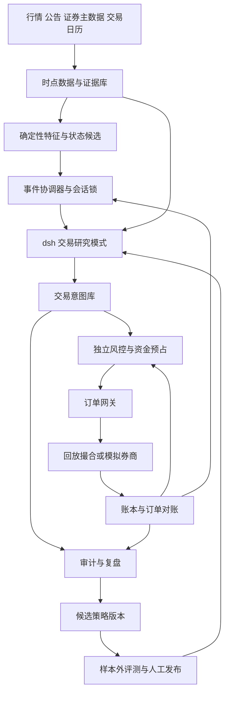

<!-- copied byte-identical from evolving-alpha codex/lunhui-agent-design @ 2ae4df0, 2026-10-19 -->
# 系统设计

设计日期：2026-10-01（用户时区）。交易日历与盘中时间统一使用 `Asia/Shanghai`，存储时间使用带时区的 UTC 时间戳。

## 1. 系统应该完成什么

系统每天形成一份可以被反驳的交易计划，盘中只对计划涉及的证据变化作出响应，盘后检查判断与实际成交之间的差距。它必须能回答：当前在交易什么市场结构，为什么选择这个题材和个股，什么变化会使判断失效，允许承担多少风险，为什么有时不交易。

《轮回》强调“计划交易”“没有模式内的就不买”（P0011–P0012）。因此空仓是正常决策，交易次数和模型调用次数都不是优化目标。系统不把历史截图里的成功案例当成完整训练集，也不把“满仓核心龙头”（P0028）直接编译成仓位指令。

### 产品交互

首页是当日工作台：市场状态、候选题材、冻结的盘前计划、待验证信号、持仓和未完成订单。每个候选只有一张决策卡，显示观察时点、支持与反对证据、触发条件、失效条件、价格有效区间、风险裁决及当前订单状态。

用户可以查看某次决策的完整证据链，标记原文解释是否合理，在模拟环境中比较不同参数。用户修改策略或风险参数后生成新版本，已有决策保留旧版本记录。复盘建议进入待评审列表，不自动覆盖次日策略。

## 2. 整体架构

这张图是目标架构，不表示现有实现。生产交易网关是以后替换模拟适配器的边界；本轮没有启用实盘，也不创建券商账户或自动任务。

### 职责分配

| 层 | 应当拥有 | 不应拥有 |
|---|---|---|
| dsh 运行时 | 模型调用、上下文、工具编排、会话、子任务、可观测轨迹 | 资金与持仓的最终解释权 |
| 策略领域 | 时点特征、市场与题材状态、冻结预期、策略匹配、交易意图 | 修改交易所规则或风险上限的权限 |
| 风控与执行 | 证券规则、可用资金和可卖数量、原子预占、订单状态机、对账 | 自行发明题材或放宽策略条件 |
| 评测与发布 | 数据版本、实验登记、回放、样本外检验、配置签名 | 自动把复盘故事升级为实盘策略 |

初期用一个 TypeScript 领域服务承载数据接口、特征、风控、事件和账本，配一个独立 dsh worker 进程；两者用受限接口通信。不是每个概念都拆成微服务。持久化优先 PostgreSQL 事务与 outbox，原始行情和公告保存在带哈希的对象或文件存储；早期文件回放也必须遵守相同契约。这个技术选型属于新设计，不继承旧项目。

## 3. 一个协调者与三个受限研究角色

| 角色 | 输入 | 输出 | 权限与约束 |
|---|---|---|---|
| 主协调者 | 同一个决策快照、当前计划、持仓摘要 | WAIT / WATCH / PROPOSE / REDUCE / EXIT 意图 | 单个账户同一时刻只允许一个有效决策修订 |
| 市场与题材分析员 | 广度、赚钱亏钱效应、题材传播、催化证据 | 市场状态、主线候选、状态冲突 | 只能读证据与写分析工件 |
| 个股与预期分析员 | 候选集合、历史冻结预期、盘中观测 | 地位假设、预期差、候选触发条件 | 只能在授权证券集合内研究 |
| 反证审查员 | 前两者的论点与同一时点数据 | 最强反例、缺失数据、使交易失效的条件 | 不能用多数投票把反证抹掉 |

这些角色是 dsh preset / 子任务职责，不要求每次都启动三个完整 agent。先确定性筛选、再对少量候选调用模型，减少成本与延迟。反证角色与主模型可能共享偏差，不能被当成独立统计样本；硬风控由代码执行。

市场、题材、个股分析可并行。资金预占、同账户仓位变更、同标的订单变更必须串行化。所有子任务绑定同一个 `snapshot_id`；过期或时点不同的结果不能拼成一份“当前”决策。

## 4. 状态与动作分开

分别维护指数和流动性环境、全市场情绪、题材阶段、个股地位。市场回暖不等于所有题材可买；某个高位股强势也不等于市场进入新周期。

市场状态候选为 `UNKNOWN / CHAOS / IGNITION / EXPANSION / CLIMAX / RETREAT / REPAIR`。它们是可修订假设，不是天然真值，也不强制按固定顺序循环。允许从任意状态进入 `UNKNOWN` 或 `RETREAT`。状态变更需记录证据变化和前一版本，且不能回写过去的标签。

采用双阈值和最短确认窗口抑制抖动，参数用训练样本选择；突发风险事件可直接触发降仓或停止新增。不同数据指标强烈冲突时标记 `UNKNOWN`，不让 LLM 用一段叙事消除冲突。

策略动作与账户动作分别记录：`EXIT` 表示希望退出，不等于已经能卖，更不等于已成交。当天买入不可卖、跌停无买盘和未知订单都必须显式显示残余风险。

## 5. 一天如何运行

以下时间为产品调度示例，交易状态以交易所日历和证券规则适配器为准。

1. **08:45–09:15 盘前**：核验交易日、数据源、上一日账本和待处理订单；读取到当前时点已公开的公告。冻结市场假设、候选主线、预期区间、观察名单、失效条件及当天风险配置。
2. **09:15–09:30 观察竞价**：记录竞价中的撤单变化、量价和题材一致性。首版只更新证据，竞价成交和抢一字不执行。高开不能独立定义为超预期。
3. **连续竞价期间**：事件协调器聚合价格、题材广度、公告和状态变化。达到预设触发条件才提交新分析任务；相同 `account + snapshot + strategy + symbol + revision` 去重。计划变更保存新修订和时间戳，原计划保留。
4. **交易意图产生后**：先验证结构和证据时间，再检查确定性策略门槛。风控服务重新读取最新账户和证券规则，原子预占，形成短期有效的风险许可；网关检查许可与意图一致、价格仍在范围内后发送。
5. **盘后**：对账优先于写复盘。分别归因于信息、解释、策略、风险、执行和成本；同时评估未交易候选。复盘只产出实验建议和数据问题，不修改运行中的代码、提示词或参数。

午休和非交易日不重复询问模型“现在能否交易”。独立日历与市场事件协调器控制运行窗口，dsh 自带日程功能仅用于可容忍延迟的盘前提醒和盘后报告。

## 6. 决策闭环

输入快照 → 获取证据 → 提出主张与反证 → 校验预期差 → 匹配策略 → 生成意图 → 确定性风险裁决 → 模拟执行 → 对账 → 评估。

每次输出包含：`as_of`、`snapshot_id`、状态及冲突、策略版本、证据 ID、反证、失效条件、动作、有效期。模型的 `confidence` 仅表达主观确信度，不能直接乘仓位或解释为胜率。经样本外校准前不显示“盈利概率”。

一次决策的预算建议初值为最多 3 个候选、8 次工具调用、2 次结构纠正、20 秒总期限；这些只是待压测的工程初值。超过期限的交易提案过期；停止新增，已有持仓和在途订单交给确定性管理规则。订单回报和撤单不等待 LLM。

## 7. 故障与恢复

| 情况 | 新增风险 | 已有风险 | 恢复条件 |
|---|---|---|---|
| 行情过期或来源冲突 | 停止新增 | 使用仍可信的账户和行情执行已登记退出规则；数据不够则记录无法执行 | 数据连续恢复并重建快照 |
| 模型超时或 JSON 无效 | WAIT，限制重试 | 不阻塞回报、对账或已登记退出规则 | 后续新事件触发新任务 |
| dsh 进程重启 | 未落库意图作废 | 订单网关继续维护在途订单 | 从领域快照重建上下文；不重播写工具 |
| 下单响应超时 | 同意图禁止重发 | 订单进入 UNKNOWN，保留资金预占并查询 | 券商查询或人工对账确认 |
| 风控或账本不可用 | 禁止提交新单 | 撤单与应急通道有独立、可审计的最小权限 | 对账一致后解除冻结 |
| 证券停牌或跌停无流动性 | 禁止增加该标的风险 | 记录退出未成交，不虚构止损成交 | 恢复可交易后按计划管理 |
| 插件卸载或工具版本变化 | 当前提案作废 | 已接受订单由网关继续管理 | 版本锁定、适配测试完成后重新生成计划 |

## 8. 可解释的复盘与受控学习

每个判断可以追溯到原文规则 ID、当时可见数据和具体实验版本。维护三类独立记录：客观事件账本、模型决策轨迹、待验证研究记忆。模型总结不能覆盖成交事实，也不能把事后涨幅写回为当时的“龙头置信度”。

允许 agent 自动提出新特征、失败模式分类和对照实验；实验在离线受限环境运行。策略进入下一个环境要经过冻结样本外窗口、成本敏感性分析、工程故障测试和人工发布。目标函数优先控制违规、回撤和不可成交暴露，再看成本后的收益质量。
